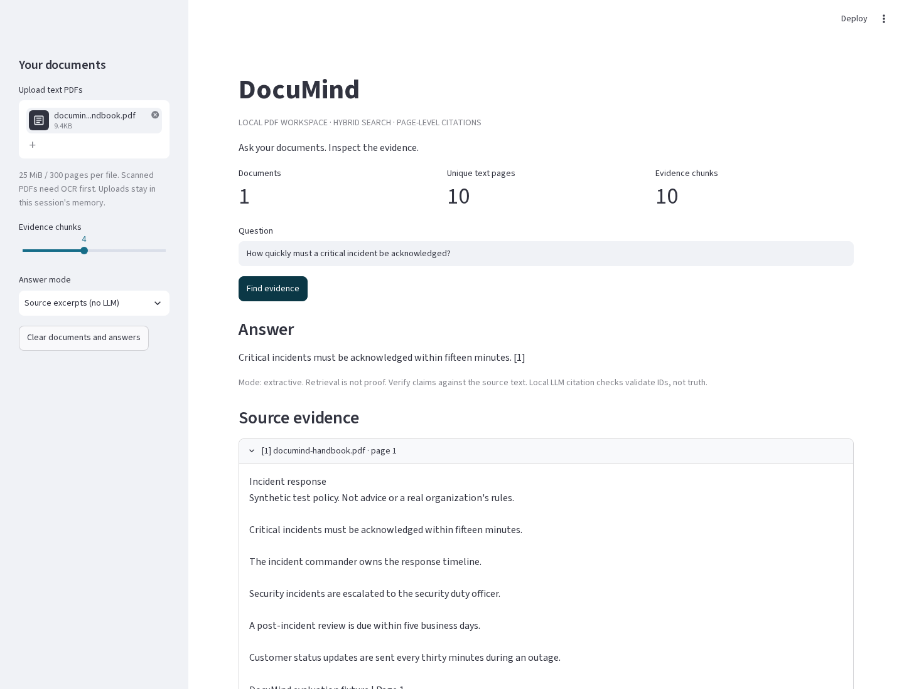

# DocuMind

**Local PDF question answering with evidence you can inspect.**

Upload text PDFs, ask a question, and see exact source excerpts with page-level citations. MiniLM embeddings and FAISS semantic search combine with BM25 keyword search through reciprocal rank fusion. No paid APIs, cloud account, GPU, or API key is needed for the default flow.



## What works

- PDF parsing with PyMuPDF, text cleanup, de-hyphenation, duplicate-page removal and SHA-256 document IDs.
- Recursive boundary-aware chunking with overlap; source filename, original page number, title and stable chunk ID travel through retrieval.
- Hugging Face `sentence-transformers/all-MiniLM-L6-v2` CPU embeddings; normalized FAISS inner-product search and BM25 combined with RRF (constant 60).
- Exact extractive answers by default, without pretending an LLM generated them. Optional local Ollama synthesis is available separately.
- Streamlit document upload, session-local indexes, configurable evidence count, answer and source evidence panels.
- A non-root Dockerfile, CI definition, test suite, 50-question evaluation set, raw predictions, and a separate optional RAGAS runner.

## Run on Windows, 16 GB RAM, no GPU

Install Python 3.11 or 3.12, then run in PowerShell from this directory:

```powershell
py -3.11 -m venv .venv
.\.venv\Scripts\Activate.ps1
python -m pip install --upgrade pip
pip install torch --index-url https://download.pytorch.org/whl/cpu
pip install -e ".[dev]"
streamlit run app.py
```

If script activation is blocked, use `.\.venv\Scripts\python.exe -m pip ...` and `.\.venv\Scripts\python.exe -m streamlit run app.py` directly, without changing machine-wide execution policy. Open the localhost URL printed by Streamlit. Upload `data/sample/documind-handbook.pdf`. Ask: "How quickly must a critical incident be acknowledged?"

First startup downloads the free MiniLM embedding model. Subsequent runs can use its local Hugging Face cache. Initial download needs an internet connection; PDF contents are not sent to Hugging Face. Start with one to five small PDFs. Limits: 25 MiB / 300 pages per file, 50 MiB / five files per session. Large document sets need an ingestion queue and persistent vector store, neither is included here.

Linux/macOS: use `python3 -m venv .venv` and `source .venv/bin/activate`; the remaining commands are the same. Code requires Python 3.10-3.13. The committed run used Python 3.10.12 on Linux CPU, not Windows. Windows instructions have not been executed on a Windows machine.

### Optional local generation

Install Ollama from https://ollama.com and run:

```text
ollama pull qwen2.5:1.5b
ollama serve
```

Choose **Local Ollama** in the sidebar. The app calls only `127.0.0.1:11434`, has no configurable remote endpoint and falls back to source excerpts when Ollama is unavailable or citations are missing/invalid. It checks citation IDs, not entailment. A small local LLM can hallucinate; inspect source evidence. Local generation is implemented but was not exercised with an actual model in the recorded run. The prompt is a best-effort instruction boundary, not a prompt-injection security guarantee.

## Architecture

```text
PDF bytes -> limits / parse / clean / deduplicate -> Page metadata
          -> recursive chunks -> MiniLM embeddings -> FAISS
                              -> tokens -> BM25
question -> dense rank + sparse rank -> reciprocal rank fusion
         -> evidence chunks -> exact excerpt OR optional local Ollama
                            -> answer + filename / page / chunk citations
```

Uploaded PDF bytes, extracted text and indexes are held in the current Streamlit session, not persisted by this application. The embedding model is process-shared through a resource cache; document indexes are not. A deployment operator could still see server memory, logs or traffic. This app has no login, TLS, encrypted storage, access audit, OCR, cross-encoder reranker or persistent upload store. It is a local portfolio project, not a multi-tenant production document system.

## Measured evaluation, including limits

The sample handbook and all 50 questions are authored synthetic fixtures, not real organization policies or a public benchmark. There are ten pages and ten indexed chunks. Questions reference facts in the same corpus. This is a narrow regression sanity check, not evidence of performance on arbitrary PDFs. BM25 already solves this simple task well; the data do not show hybrid retrieval beating BM25.

Measured on Linux CPU, 50 questions, warm-query latency.

| Mode | Top-1 page hit | Recall@4 | Expected substring | Median / p95 (ms) |
|---|---:|---:|---:|---:|
| bm25 | 100% | 100% | 96% | 0.177 / 0.213 |
| dense | 98% | 100% | 96% | 8.973 / 11.519 |
| hybrid | 100% | 100% | 96% | 8.191 / 9.768 |

`answer_contains_expected` is a case-insensitive expected-substring check, **not answer accuracy, faithfulness, or RAGAS**. The answer is one selected source sentence, so it sometimes selects the wrong fact even when retrieval finds the right page. Dense-only and BM25-only use the same chunk set, top-k and extractive answer stage. BM25 query latency does not include embedding inference. Timings exclude cold model load and ingestion, and are machine-specific, not laptop promises. Raw per-question outputs are committed in `evaluation/predictions.jsonl` and environment details in `evaluation/results.json`.

Reproduce:

```text
python scripts/make_fixture.py
python scripts/evaluate.py
pytest -q
ruff check .
```

The fixture generator uses deterministic PDF metadata. No training or fine-tuning occurs. The embedder is pretrained; labels are used only for evaluation. There is no external holdout set.

### RAGAS faithfulness and answer relevancy

A separate runner uses **real RAGAS 0.2.15**, a local Ollama judge, and Ollama embeddings. These metrics have **not been run** in the committed result. There are no RAGAS numbers to claim. Install and run them on your laptop if you want judge-based scores:

```text
pip install -e ".[eval]"
ollama pull qwen2.5:3b
ollama pull nomic-embed-text
python scripts/evaluate_ragas.py --judge qwen2.5:3b
```

The runner evaluates the 50 stored hybrid extractive answers, saves per-question judge outputs plus valid/failed score counts, and never replaces failed scores with zeros or made-up results. Local judging can be slow and model-dependent; inspect failures and manually review a sample. The 3B judge may need several GB of extra RAM; run it separately from the app on a 16 GB laptop. The runner imports against the installed optional dependencies, but a complete judge pass still needs execution.

## Tests

The recorded run passed 22 tests. Tests use deterministic fake embeddings so CI does not need a network/model download. Integration evaluation uses the actual Hugging Face model. The UI smoke script performs a real upload and question submission with Playwright, then saves screenshots:

```text
pip install playwright
python -m playwright install chromium
python scripts/ui_smoke.py
```

The smoke script is a developer utility using a POSIX virtual-environment executable path. On Windows, run the app normally or adapt that utility's executable path. `requirements-tested.txt` records the exact environment of the measured run; `pyproject.toml` is the supported dependency contract. CI configuration is supplied, but no successful GitHub Actions run is claimed until one appears in GitHub.

## Docker

```text
docker build -t documind-rag .
docker run --rm -p 127.0.0.1:8501:8501 -v documind-models:/home/app/.cache/huggingface documind-rag
```

The image uses a non-root user, a health check and CPU-only PyTorch. Its first query/download needs outbound network access. Docker was not available in the build environment, so image build/run remain unverified. Default extractive mode works without Ollama. An Ollama service running on the host is not reachable at the container's loopback address; optional LLM generation inside Docker requires its own deployment/network configuration and is not enabled by the default command.

## EC2 deployment status

**Not deployed to AWS EC2.** No AWS resource has been created and no billable service is required. See [the deployment checklist](docs/ec2.md) for a cautious self-hosting path, including cost checks and access controls. A deployment guide is not a deployed app. Do not describe this project as EC2-deployed until you have verified a real deployment yourself.

## Repository map

```text
app.py                         Streamlit UI
src/documind/core.py            parsing, chunking, retrieval, exact excerpts
src/documind/generate.py        optional localhost-only Ollama synthesis
scripts/make_fixture.py         authored PDF and 50 QA fixture generator
scripts/evaluate.py             measured retrieval / extractive baseline
scripts/evaluate_ragas.py       optional local RAGAS judge run
scripts/ui_smoke.py             real browser upload/query check
tests/                         deterministic unit tests
data/sample/                  sample PDF and authored source facts
evaluation/                   questions, measured results, raw predictions
docs/                         screenshots and EC2 checklist
```

## Honest project description

"Local-first PDF question-answering app with Hugging Face embeddings, FAISS/BM25 hybrid retrieval, recursive chunking, and page-level citations; tested on a transparent 50-question synthetic fixture." Mention the optional local LLM and RAGAS runner as implemented integrations, not measured generative quality or completed judge evaluation. Do not claim production readiness, external benchmark scores, a live AWS deployment, or sole unaided authorship.

## License

MIT. Sample documents and question fixtures were authored for this repository. Third-party code and pretrained models retain their respective licenses; review those before redistribution or commercial use.
